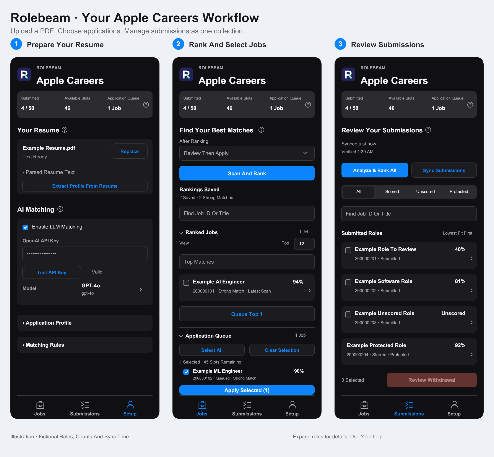

# Rolebeam

*Previously Career Peeler.*

An unofficial Chrome extension for Apple Careers. Upload your resume, rank filtered jobs, choose which ones to apply for, and review your existing submissions.



*Illustration of the current controls. Roles, counts, and sync time are fictional examples.*

## Install

Requires Chrome 120 or newer and your own OpenAI API key.

```sh
npm install
npm run build
```

In Chrome, open **Extensions → Developer Mode → Load Unpacked** and select `dist/`. Click the Rolebeam extension icon to open its side panel. Sign in to [Apple Careers](https://jobs.apple.com/).

## Start With Setup

1. Open **Setup → Your Resume → Upload Resume** and choose a PDF.
2. Under **AI Matching**, check **Enable LLM Matching**, enter your OpenAI API key, and click **Test API Key**. Tap **Model** to open the selection sheet, choose from **Recommended** or search the compatible models available to your key, then tap **Done**.
3. Click **Extract Profile From Resume** if the profile is not ready. Review the extracted profile and **Parsed Resume Text**.
4. Expand **Application Profile** and check your experience and required application answers. Save your own work authorization, sponsorship, age eligibility, prior Apple employment and start availability. These start unset; a saved date or explicit **Immediately** controls availability.
5. In **Saved Question Answers**, copy the exact wording of a criminal-history or differently scoped question and save your own Yes/No answer. Answers only cover that wording. Missing, conflicting, expired or unsupported personal answers stop the role for manual review; the extension does not guess them from your resume or ask AI to invent them.

The model picker uses a curated full-size model list with GPT-4o as the baseline. Mini, nano and specialized models are excluded. Model discovery reads OpenAI's models endpoint; it does not send your resume or generate a paid completion. A failed refresh keeps your saved choice. Changing models makes prior matching results stale; it does not silently rerun a scan or change an active workflow. See [Model Selection](docs/model-selection.md) for compatibility and availability limits.

## Find And Apply For Jobs

In your Apple Careers tab, set the search filters you want. Then open the extension's **Jobs** tab.

### Choose Roles Yourself

1. Set **After Ranking** to **Review Then Apply**, then click **Scan And Rank**. It ranks the entire filtered search before you apply.
2. Expand **Ranked Jobs** and inspect roles' match details and evidence. Check specific roles and click **Queue Selected** below the ranked list, or set **Top** and click **Queue Top N** there.
3. Expand **Application Queue**. Check the roles you want to apply for—each starts unchecked. Use **Select All** or **Clear Selection** as needed.
4. Click **Apply Selected (N)** below the application queue. The confirmation sheet lists only those roles. Review any concerns, allow submission, then click **Confirm And Apply (N)**.

If an earlier application was interrupted, the review sheet automatically checks Apple submissions first. It shows **Checking Previous Applications…**, offers **Retry Check** if verification fails, and requires your confirmation after a successful check. Submitted or unresolved selected roles require reviewing the selection again.

For an unresolved application, open its **Review** job link and click **Check Application Status**. This checks Active submissions and refreshes the exact job-detail page without submitting anything. A confirmed earlier submission stays confirmed; an interruption before Submit requires a new review. An unknown Submit is never retried automatically. Apple must provide job-specific confirmation; a base-only ID, generic Submitted label or Apply button cannot clear an unknown outcome. See [Application Recovery](docs/application-recovery.md).

The scan summary counts jobs found and strong matches in **This Scan**. **Scan Details** shows cached jobs across filters separately. If pagination pauses, reopen the same filter and choose **Resume Scan**; completed scores are kept. A changed resume or filter requires **Scan And Rank**. Partial scans do not start automatic applications.

**Queue Top N** shows how many jobs it can add: the smaller of your Top setting, available results, and open slots. For example, one available result with 13 open slots shows **Queue Top 1**. You can set Top below the number of open slots.

Selected roles are processed in score order after checking available slots. Unselected roles and roles beyond available capacity stay queued. Adding a role to the queue does not submit an application.

A live selection counter shows how many slots remain to be covered. It tells you when enough roles are selected and when the selection exceeds available slots. Extra selections are allowed as backups if an application fails. The capacity notice stays visible while you scroll the application queue and is repeated in the confirmation sheet.

**Preparing Batch** loads your selected roles' saved scores. After confirmation, **Checking Submission Capacity** verifies all active applications before applying. It reuses a suitable submissions tab in the same window and restores its page, or opens and closes a temporary background tab. This check can take several seconds while Apple loads each submissions page.

### Apply Strong Matches Automatically

Set **After Ranking** to **Auto Apply Strong Matches**, check **I Allow Strong Match Applications After Ranking**, then click **Scan And Rank**. Applications begin only after the full search finishes successfully. Roles with match concerns remain available for manual review.

The header labels **Submitted**, **Available Slots**, and **Application Queue** separately. **Cached Count** identifies a previously verified count; **Not Verified** and **—** mean current capacity is unknown, not zero. Capacity includes pending reservations, uses a conservative limit of 50 active submissions, and is checked again before applying.

## Review Existing Submissions

Open **Submissions** in the extension.

| Button | What It Does |
| --- | --- |
| **Sync Submissions** | Updates saved submissions and the count without new AI matching. Reuses a ready submissions tab in the same window and restores its page, or opens and closes a temporary background tab. Your filtered search stays in place. |
| **Analyze & Rank All** | Reads all submissions and scores roles against your resume. Reviewable roles appear with the lowest fit first. |

Saved submissions load immediately as one deduplicated collection. Use **All**, **Scored**, **Unscored**, or **Protected**, and **Find Job ID Or Title** to locate a role. Check the applications you want to withdraw, click **Review Withdrawal**, and review the confirmation sheet before continuing. Protected roles cannot be selected. A partial update retains older saved roles with a visible warning until the complete inventory is verified.

Visiting Apple's **Submissions → Active** automatically checks the current page without opening tabs, moving through pages, or running AI analysis. It can verify the count when the complete inventory fits on one page. For multiple pages, automatic sync is deferred; use **Sync Submissions** to verify all pages and restore your place.

The compact sync indicator shows **Syncing**, the last successful sync time, **Sync Failed** with **Retry**, or **Sync Deferred**. Its last successful timestamp survives panel reopening and worker restarts. An interrupted or failed check leaves capacity unverified until a complete sync succeeds. **Analyze & Rank All** is the separate action for AI scoring.

**Apple withdrawals cannot be undone, and you cannot reapply for a withdrawn role.**

## When Something Stops

- **Interrupted scan:** use **Resume Scan** with the same search filters. Saved results remain available, and valid cached scores are reused.
- **Failed application:** expand **Activity** for the job link, reason, and last step. Known failures before submission are skipped; an unknown submission outcome pauses the batch for review.
- **Changed submissions:** automatic checks use the current Active Submissions page. Use **Sync Submissions** if all pages are needed. A visible Submitted marker on a job page can update that role's saved status; the complete count is verified again before applying.

After a manual application is verified, its earlier failure is labeled **Submitted Later** and kept under **Previous Failure**. New application activity is grouped by job and includes each Continue step. Older unassigned activity can contain steps from several roles.

To apply one reviewed role, open its Apple job page and choose **Apply This Role** in the Jobs tab. Review the role and confirm submission. The extension checks available slots, then completes the application stages using your saved profile. It does not require a queue entry or a strong match score. If a step fails, the application stays open and Activity records the job link and reason. A previous unknown Submit outcome requires reconciliation; absence from the submissions list alone does not authorize an automatic retry.

Small **?** buttons explain controls. Expand a role to see its details; opening another role in the same list closes the previous one.

**Application Queue Finished** means the selected batch was processed, which can include failed applications. The last batch summary shows submitted, already submitted, and review counts. Unselected roles stay queued even if slots remain open.

Reloading restores saved rankings, your Top setting, search text, and View filter. It does not start a scan or add jobs to Application Queue. Ranked Jobs draws from saved scores across scanned filters; lower-ranked saved roles can become visible as higher-ranked roles are applied or withdrawn.

## Data And Development

Resume and job data are saved on your device. AI features send the PDF or relevant resume and job information to OpenAI using your key. See [Privacy](PRIVACY.md) and [Storage Details](docs/storage.md).

After editing the extension, run `npm run build` and reload it in Chrome's Extensions page. Reload open Apple Careers pages too so they use the current page reader. Updating the same extension installation and ID retains saved data, including data created under the Career Peeler name. A separate installation or Chrome Web Store item has separate local storage. The React side panel is bundled; background, content, and shared library scripts are copied into `dist/`.

For development, install dependencies with `npm ci`, then run `npm test` and `npm run check`. The default test command discovers every top-level test file, runs all suites with Node's test runner, and blocks unmocked fetch requests. Tests use synthetic Apple pages and in-memory IndexedDB; they do not submit or withdraw real applications. See [Testing](docs/testing.md) for fixtures and coverage limits.
